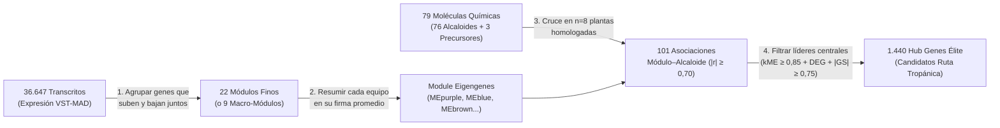

# Guía Fácil para Entender y Sustentar los Resultados del Objetivo 3 (WGCNA + Metabolómica + *Hub Genes*)

> **En una sola frase**: *En el Objetivo 3 descubrimos cómo los **36.647 genes activos** de las plantas del clado Datura se organizan en **equipos coordinados de trabajo (módulos)** según el piso térmico (Alta Montaña vs. Tierras Bajas), identificamos exactamente **qué equipos de genes se encienden cuando sube la producción de alcaloides tropánicos específicos**, y seleccionamos los **1.440 "genes capitanes" (Hub Genes)** que lideran esa producción química.*

---

## 1. El Problema Inicial: ¿Cómo conectar `36.647` genes con `79` compuestos químicos en solo `10` plantas?

Imagina que cada planta es una **fábrica química** que produce alcaloides tropánicos (como escopolamina, hiosciamina y otros $76$ derivados más $3$ precursores).
- Del **Objetivo 2** salimos con una lista depurada de **36.647 transcritos (genes activos)** medidos en nuestras muestras.
- Del laboratorio químico teníamos la medición de **79 moléculas** ($76$ alcaloides `X6T..X81T` + $3$ precursores `X82P..X84P`).

**¿Por qué NO podíamos simplemente correlacionar cada uno de los `36.647` genes contra los `79` alcaloides uno por uno?**
Porque $36.647 \times 79 = 2.895.113$ pruebas estadísticas individuales. Con pocas muestras ($8\text{ a }9$ plantas), hacer casi 3 millones de comparaciones directas produciría miles de coincidencias por pura casualidad (falsos positivos).

### La solución: Agrupar genes en "Equipos de Trabajo" con `WGCNA`
Los genes que participan en una misma ruta biológica no trabajan solos: **se encienden y se apagan al mismo tiempo**.
1. **`WGCNA` (Red de Co-expresión)** busca cuáles de los $36.647$ genes suben y bajan juntos a través de las plantas y los agrupa en **Módulos (identificados con nombres de colores: `turquoise`, `blue`, `purple`, `brown`, etc.)**.
2. Para cada módulo, `WGCNA` calcula un **"Perfil Promedio del Equipo" llamado *Module Eigengene* (`ME`)**: una sola curva que resume cómo se comporta todo ese grupo de cientos o miles de genes.
3. Así, en lugar de hacer 3 millones de pruebas ruidosas, correlacionamos **los perfiles de los equipos (`ME`) contra los alcaloides**.

---

## 2. Dos Limpiezas Clave que Salvaron el Resultado (Auditoría Forense)

Antes de obtener el resultado definitivo, detectamos y corregimos **dos trampas ocultas en los datos**:

1. **¿Por qué retiramos la muestra `B19` (*Atropa belladonna*) de la red? (`n = 10` → `n = 9`)**:
   - `B19` es un grupo externo (*outgroup* de otro género evolutivo) y además tuvo muy pocas lecturas en secuenciación ($122\text{ mil}$ vs. $4\text{ a }22\text{ millones}$ en *Brugmansia*).
   - Cuando dejábamos a `B19` dentro de `WGCNA`, la red creaba un módulo artificial gigantesco (`brown` de $3.222$ genes) que solo servía para decir *"Atropa es distinta de Brugmansia"*, metiendo **$614$ genes falsos positivos**.
   - Al retirar `B19` y quedarnos con las **9 muestras del clado de interés (`B9, B10, B11, B12, B14, B15, B17, B21, B27`)**, la basura (`grey`) cayó a solo **$8,10\%$** ($2.970$ genes) y aparecieron módulos limpios por piso térmico.
2. **¿Por qué rescatamos los decimales del archivo Excel original de Metabolómica?**:
   - El archivo plano previo (`fenotipos_TA_limpios_para_WGCNA.csv`) había perdido el punto decimal en **339 celdas** (convirtiendo por ejemplo `14.52` en `1452`, multiplicando por $100\times$).
   - Al reconstruir [`fenotipos_TA_corregidos_para_WGCNA.csv`](../../fenotipos_TA_corregidos_para_WGCNA.csv) directamente desde el Excel original, recuperamos las correlaciones reales y alineamos exactamente las **8 muestras que tienen tanto RNA-seq como Metabolómica (`B9, B10, B11, B12, B14, B15, B17, B21`)**.

---

## 3. ¿Cómo Leer los Dendrogramas (`Fig09` y `Fig10`)? Los 22 Módulos vs. los 9 Macro-Módulos

En las **Figuras 9 y 10** vemos el "árbol genealógico" (dendrograma) de cómo se agrupan los $36.647$ transcritos:
- **Vista con Lupa Fina (`mergeCutHeight = 0.25`, banda superior de `Fig09` y línea roja de `Fig10`)**:
  - Exige que dos módulos sean casi idénticos ($r > 0,75$) para unirlos. Por eso conserva **22 módulos específicos**.
- **Vista Panorámica (`mergeCutHeight = 0.38` + `minModuleSize = 150`, banda inferior de `Fig09` y línea azul de `Fig10`)**:
  - Une a los "módulos hermanos" que trabajan en el mismo piso térmico ($r > 0,62$). Así se ve que los 22 módulos en realidad forman **3 Grandes Bloques Ecológicos (9 Macro-Módulos + `grey`)**:

| Gran Bloque Ecológico | Módulos Finos que lo Integran (Vista de 22 módulos) | Macro-Módulos (Vista consolidada) | ¿Dónde se encienden estos genes? |
| :--- | :--- | :--- | :--- |
| **1. Bloque de Tierras Bajas (Subclado B)** | `MEturquoise` ($17.694$), `MEblue` ($2.345$), `MEblack` ($966$), `MEmagenta` ($806$), `MEsalmon` ($678$) | Macro-módulo **`turquoise`** ($22.489$ genes, **$61,4\%$**) | Fuertemente activos en clima cálido/bajo: `B9` (*B. insignis*), `B12` (*B. suaveolens*), `B14` (*B. versicolor*) y `B21` (*B. aurea*). |
| **2. Bloque de Alta Montaña (Subclado A)** | `MEyellow` ($1.573$), `MEpurple` ($736$), `MEgreenyellow` ($704$), `MEmidnightblue` ($469$) | Macro-módulo **`yellow`** ($3.482$ genes, **$9,5\%$**) | Exclusivos del páramo/alta montaña: `B10` (*B. sanguinea*), `B11` (híbrido) y `B15` (*B. vulcanicola*). |
| **3. Bloque Herbáceo Clado *Datura*** | `MEbrown` ($1.736$), `MEred` ($1.427$), `MEtan` ($685$), `MEcyan` ($604$) | **`brown`**, **`red`**, **`tan`**, **`cyan`** ($5.357$ genes, **$14,6\%$**) | Exclusivos de las plantas herbáceas anuales: `B17` (*D. stramonium*) y `B27` (*D. wrightii*). |

---

## 4. El Resultado Estrella (`Fig07`): ¿Qué Equipos de Genes se Asocian con Qué Alcaloides?

Cuando cruzamos los equipos de genes con los alcaloides en la **Figura 7** ([`Fig07_WGCNA_Heatmap_Modulo_Alcaloide_Fase2.png`](./03_Figuras_Publicacion/Fig07_WGCNA_Heatmap_Modulo_Alcaloide_Fase2.png)), encontramos **101 asociaciones estadísticamente significativas** ($\|r\| \ge 0,70, p \le 0,05$). Las tres historias biológicas más claras para tu sustentación son:

### Historia A: El equipo productor de Tierras Bajas (`MEblue` y `MEmagenta`) → Alcaloide `X70T` y Precursor `X82P`
- Los módulos **`MEblue`** ($2.345$ genes) y **`MEmagenta`** ($806$ genes), que están encendidos en las especies de **Tierras Bajas (`B9, B12, B14, B21`)**, tienen una correlación positiva altísima con el alcaloide **`X70T`**:
  - `MEblue` vs. `X70T`: **$r = +0,92$ ($p = 0,0012$)**
  - `MEmagenta` vs. `X70T`: **$r = +0,91$ ($p = 0,0015$)**
  - `MEturquoise` vs. `X70T`: **$r = +0,89$ ($p = 0,0031$)**
- Además, **`MEmagenta`** se correlaciona directamente con el **Precursor `X82P`** (**$r = +0,88, p = 0,0036$** en escala logarítmica y **$r = +0,95, p = 0,0003$** en escala lineal) y con los alcaloides **`X60T`** ($r = +0,88$) y **`X59T`** ($r = +0,86$).
- **Interpretación biológica sencilla**: En Tierras Bajas, el conjunto de genes de `MEmagenta` y `MEblue` impulsa simultáneamente la disponibilidad del precursor `X82P` y su conversión hacia los alcaloides `X70T`, `X60T` y `X59T`.

### Historia B: El contraste de Alta Montaña (`MEpurple`) vs. Alcaloide `X52T` y `X12T`
- El módulo **`MEpurple`** ($736$ genes) está encendido **únicamente en Alta Montaña (`B10, B11, B15`)**.
- Muestra una correlación negativa casi perfecta con el alcaloide **`X52T`** (**$r = -0,97, p = 0,00008$**): es decir, cuando el programa genético de Alta Montaña (`MEpurple`) se activa, la ruta hacia `X52T` se apaga (o se desvía hacia otros compuestos como `X12T`, donde `MEpurple` tiene $r = +0,69$ y `MEpink` alcanza $r = +0,85$).

### Historia C: La firma química propia de *Datura stramonium* (`MEbrown`, `MEred`, `MEcyan`)
- Los módulos específicos de *Datura* muestran el patrón exactamente opuesto al de *Brugmansia* de tierras bajas: **`MEred`** se opone a `X70T` ($r = -0,97$) pero se asocia fuertemente con **`X13T`** ($r = +0,86$), mientras que **`MEbrown`** impulsa a **`X52T`** ($r = +0,86$). Esto demuestra que la divergencia evolutiva entre árboles (*Brugmansia*) y hierbas (*Datura*) reprograma módulos enteros de la ruta tropánica.

---

## 5. El Embudo Final (`Fig08`): ¿Cómo elegimos a los `1.440` *Hub Genes* ("Capitanes de Equipo")?

Tener módulos de miles de genes sigue siendo demasiado grande para validar en el laboratorio o buscar enzimas clave. Por eso, en la **Figura 8** ([`Fig08_Volcano_DEGs_y_HubGenes_MM_vs_GS.png`](./03_Figuras_Publicacion/Fig08_Volcano_DEGs_y_HubGenes_MM_vs_GS.png)) aplicamos una **triple criba de precisión** sobre los $36.647$ transcritos:

1. **Requisito 1 — Que cambie fuertemente entre pisos térmicos (Volcano Plot, Panel A)**:
   - Filtramos los transcritos con cambio de expresión de al menos $2,8\text{ veces}$ ($\|\log_2\text{FC}\| \ge 1,5$) y significancia estadística ($p \le 0,01$) entre Alta Montaña y Tierras Bajas $\rightarrow$ **3.096 transcritos diferenciales (DEGs)**.
2. **Requisito 2 — Que sea un "Capitán" dentro de su módulo ($\text{kME} \ge 0,85$, eje X del Panel B)**:
   - La membresía modular ($\text{kME}$) mide qué tan conectado está un gen con el resto de su equipo. Un $\text{kME} \ge 0,85$ garantiza que no es un gen periférico, sino un **regulador o enzima central (*Hub Gene*)** de su módulo.
3. **Requisito 3 — Que correlacione directamente con la acumulación del alcaloide ($\|\text{GS}\| \ge 0,75$, eje Y del Panel B)**:
   - La significancia génica ($\text{GS}$) mide la correlación directa entre ese gen individual y los alcaloides clave (`X70T`, `X52T`, `X82P`).

> **Resultado del triple filtro**: De los $36.647$ transcritos iniciales, quedaron seleccionados exactamente **1.440 *Hub Genes* candidatos de élite** (guardados en [`WGCNA_SinB19_04_Top_HubGenes_Candidatos_DEGs_TA.csv`](./02_Tablas_CSV/WGCNA_SinB19_04_Top_HubGenes_Candidatos_DEGs_TA.csv)), encabezados por transcritos como `NODE_1270` ($\text{kME} = 0,95, r_{\text{X70T}} = +0,99$), `NODE_28074` ($\text{kME} = 0,90, r_{\text{X70T}} = +0,99$) y `NODE_41965` ($\text{kME} = 0,91, r_{\text{X52T}} = +0,97$).
> Esta tabla de **1.440 transcritos** es la que se cruza directamente con tu tabla de anotación `DIAMOND`/`TransDecoder` (Objetivo 1) para ponerle nombre y apellido enzimático (ej. *PMT, TR-I, TR-II, H6H, CYP80F1, Littorina sintasa*) a cada candidato.
