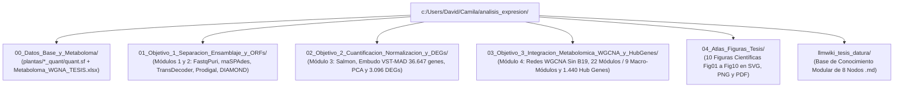

# Repositorio Tesis Hologenómica del Clado *Datura* (Organizado por Objetivos)

> **Título de la Tesis**: *"Desarrollo de un flujo computacional reproducible para caracterizar la expresión de genes precursores y biosintéticos de la ruta de alcaloides tropánicos en plantas y sus microorganismos asociados en el clado Datura."*

---

## Arquitectura Limpia de la Carpeta Raíz

---

## 0. Datos Crudos y Metaboloma Base ([`00_Datos_Base_y_Metaboloma/`](./00_Datos_Base_y_Metaboloma))
- [`plantas/plantas/*_quant/quant.sf`](./00_Datos_Base_y_Metaboloma/plantas/plantas): Matrices de cuantificación de `Salmon v1.10.3` para las 10 librerías vegetales (`123.099` transcritos post-`CD-HIT-EST`).
- [`Metaboloma_WGNA_TESIS.xlsx`](./00_Datos_Base_y_Metaboloma/Metaboloma_WGNA_TESIS.xlsx): Matriz metabolómica original de cromatografía ($10\text{ muestras} \times 79\text{ compuestos}$: $76$ alcaloides tropánicos `6T..81T` y $3$ precursores `82P..84P`).
- [`archivo_deprecado_corrupto/`](./00_Datos_Base_y_Metaboloma/archivo_deprecado_corrupto): Contiene el archivo histórico `fenotipos_TA_limpios_para_WGCNA_NO_USAR.csv` aislado para evitar su uso accidental por pérdida de decimales.

---

## 1. Objetivo Específico 1 ([`01_Objetivo_1_Separacion_Ensamblaje_y_ORFs/`](./01_Objetivo_1_Separacion_Ensamblaje_y_ORFs))
**Alcance (Módulos 1 y 2)**: Separación taxonómica *in silico* (`FastqPuri`), co-ensamblaje *de novo* (`rnaSPAdes`, $135.008$ contigs $\rightarrow 123.099$ transcritos tras `CD-HIT-EST`), predicción diferenciada de ORFs (`TransDecoder` para planta eucariota monocistrónica vs. `Prodigal` para bacteria procariota policistrónica) y anotación contra los 35 genes nominales de alcaloides tropánicos (`DIAMOND`).

- [`02_Tablas_CSV/Salmon_Resumen_Mapeo_Plantas.csv`](./01_Objetivo_1_Separacion_Ensamblaje_y_ORFs/02_Tablas_CSV/Salmon_Resumen_Mapeo_Plantas.csv)
- [`03_Figuras_Publicacion/Fig01_Embudo_Filtrado_Transcritos.png`](./01_Objetivo_1_Separacion_Ensamblaje_y_ORFs/03_Figuras_Publicacion/Fig01_Embudo_Filtrado_Transcritos.png)
- [`03_Figuras_Publicacion/Fig02_Salmon_Cobertura_y_Mapeo.png`](./01_Objetivo_1_Separacion_Ensamblaje_y_ORFs/03_Figuras_Publicacion/Fig02_Salmon_Cobertura_y_Mapeo.png)
- [`04_Documentacion_LLMWiki/`](./01_Objetivo_1_Separacion_Ensamblaje_y_ORFs/04_Documentacion_LLMWiki): Nodos `01` a `04` de la wiki técnica.

---

## 2. Objetivo Específico 2 ([`02_Objetivo_2_Cuantificacion_Normalizacion_y_DEGs/`](./02_Objetivo_2_Cuantificacion_Normalizacion_y_DEGs))
**Alcance (Módulo 3)**: Cuantificación en `Salmon v1.10.3`, corrección por longitud efectiva en `tximport`, embudo estadístico de 7 pasos (`123.099 → 54.363 Pre-MAD → 36.647 Post-MAD` vía `DESeq2::vst`), diagnóstico multivariado (PCA y correlación de muestras con/sin `B19`) y expresión diferencial entre Subclado A (Alta Montaña) y Subclado B (Tierras Bajas) ($3.096$ DEGs).

- **Scripts**: [`01_Scripts/Normalizacion3.R`](./02_Objetivo_2_Cuantificacion_Normalizacion_y_DEGs/01_Scripts/Normalizacion3.R), [`01_Scripts/DESeq_y_HubGenes_Candidatos.py`](./02_Objetivo_2_Cuantificacion_Normalizacion_y_DEGs/01_Scripts/DESeq_y_HubGenes_Candidatos.py)
- **Tablas CSV**:
  - [`02_Tablas_CSV/Tabla_Embudo_Filtrado_Plantas_Corregido.csv`](./02_Objetivo_2_Cuantificacion_Normalizacion_y_DEGs/02_Tablas_CSV/Tabla_Embudo_Filtrado_Plantas_Corregido.csv)
  - [`02_Tablas_CSV/matriz_vst_filtrada_para_WGCNA.csv`](./02_Objetivo_2_Cuantificacion_Normalizacion_y_DEGs/02_Tablas_CSV/matriz_vst_filtrada_para_WGCNA.csv) ($10 \times 36.647$)
  - [`02_Tablas_CSV/WGCNA_00_Correlacion_Muestras.csv`](./02_Objetivo_2_Cuantificacion_Normalizacion_y_DEGs/02_Tablas_CSV/WGCNA_00_Correlacion_Muestras.csv)
- **Figuras**: [`Fig01`](./02_Objetivo_2_Cuantificacion_Normalizacion_y_DEGs/03_Figuras_Publicacion/Fig01_Embudo_Filtrado_Transcritos.png), [`Fig02`](./02_Objetivo_2_Cuantificacion_Normalizacion_y_DEGs/03_Figuras_Publicacion/Fig02_Salmon_Cobertura_y_Mapeo.png), [`Fig03`](./02_Objetivo_2_Cuantificacion_Normalizacion_y_DEGs/03_Figuras_Publicacion/Fig03_QC_PCA_Comparativo_Muestras.png), [`Fig04`](./02_Objetivo_2_Cuantificacion_Normalizacion_y_DEGs/03_Figuras_Publicacion/Fig04_QC_Heatmap_Correlacion_Muestras.png), [`Fig08`](./02_Objetivo_2_Cuantificacion_Normalizacion_y_DEGs/03_Figuras_Publicacion/Fig08_Volcano_DEGs_y_HubGenes_MM_vs_GS.png).

---

## 3. Objetivo Específico 3 ([`03_Objetivo_3_Integracion_Metabolomica_WGCNA_y_HubGenes/`](./03_Objetivo_3_Integracion_Metabolomica_WGCNA_y_HubGenes))
**Alcance (Módulo 4)**: Curaduría decimal de los 79 compuestos (76 alcaloides tropánicos + 3 precursores), construcción de redes `WGCNA` Signed ($\beta = 12$, sin `B19`, $n=9$, solo $8,10\%$ en `grey`), dendrogramas de 22 módulos finos vs. 9 macro-módulos consolidados, correlación Módulo–Alcaloide ($101$ pares significativos con $\|r\| \ge 0,70, p \le 0,05$) y selección de los **1.440 *Hub Genes* candidatos de élite**.

- **Guía Didáctica para Sustentación**: [**`GUIA_FACIL_RESULTADOS_OBJETIVO_3.md`**](./03_Objetivo_3_Integracion_Metabolomica_WGCNA_y_HubGenes/GUIA_FACIL_RESULTADOS_OBJETIVO_3.md)
- **Scripts**: [`WGCNA1_Data.R`](./03_Objetivo_3_Integracion_Metabolomica_WGCNA_y_HubGenes/01_Scripts/WGCNA1_Data.R), [`Visualizacion_Data.R`](./03_Objetivo_3_Integracion_Metabolomica_WGCNA_y_HubGenes/01_Scripts/Visualizacion_Data.R), [`WGCNA2_Correlacion_Metaboloma.R`](./03_Objetivo_3_Integracion_Metabolomica_WGCNA_y_HubGenes/01_Scripts/WGCNA2_Correlacion_Metaboloma.R), [`generar_todas_las_figuras_tesis.py`](./03_Objetivo_3_Integracion_Metabolomica_WGCNA_y_HubGenes/01_Scripts/generar_todas_las_figuras_tesis.py), [`generar_dendrogramas_wgcna.py`](./03_Objetivo_3_Integracion_Metabolomica_WGCNA_y_HubGenes/01_Scripts/generar_dendrogramas_wgcna.py)
- **Tablas CSV**:
  - [`02_Tablas_CSV/fenotipos_TA_corregidos_para_WGCNA.csv`](./03_Objetivo_3_Integracion_Metabolomica_WGCNA_y_HubGenes/02_Tablas_CSV/fenotipos_TA_corregidos_para_WGCNA.csv) y [`02_Tablas_CSV/fenotipos_TA_homologados_n8_SinOutgroups.csv`](./03_Objetivo_3_Integracion_Metabolomica_WGCNA_y_HubGenes/02_Tablas_CSV/fenotipos_TA_homologados_n8_SinOutgroups.csv)
  - [`02_Tablas_CSV/WGCNA_SinB19_02_Resumen_Modulos.csv`](./03_Objetivo_3_Integracion_Metabolomica_WGCNA_y_HubGenes/02_Tablas_CSV/WGCNA_SinB19_02_Resumen_Modulos.csv) y [`02_Tablas_CSV/WGCNA_SinB19_02_Module_Eigengenes.csv`](./03_Objetivo_3_Integracion_Metabolomica_WGCNA_y_HubGenes/02_Tablas_CSV/WGCNA_SinB19_02_Module_Eigengenes.csv)
  - [`02_Tablas_CSV/WGCNA_SinB19_03_Top_Asociaciones_Significativas.csv`](./03_Objetivo_3_Integracion_Metabolomica_WGCNA_y_HubGenes/02_Tablas_CSV/WGCNA_SinB19_03_Top_Asociaciones_Significativas.csv)
  - [`02_Tablas_CSV/WGCNA_SinB19_04_Top_HubGenes_Candidatos_DEGs_TA.csv`](./03_Objetivo_3_Integracion_Metabolomica_WGCNA_y_HubGenes/02_Tablas_CSV/WGCNA_SinB19_04_Top_HubGenes_Candidatos_DEGs_TA.csv)
- **Figuras**: [`Fig05`](./03_Objetivo_3_Integracion_Metabolomica_WGCNA_y_HubGenes/03_Figuras_Publicacion/Fig05_WGCNA_Topologia_Libre_Escala.png), [`Fig06`](./03_Objetivo_3_Integracion_Metabolomica_WGCNA_y_HubGenes/03_Figuras_Publicacion/Fig06_WGCNA_Modulos_y_Eigengenes_SinB19.png), [`Fig07`](./03_Objetivo_3_Integracion_Metabolomica_WGCNA_y_HubGenes/03_Figuras_Publicacion/Fig07_WGCNA_Heatmap_Modulo_Alcaloide_Fase2.png), [`Fig08`](./03_Objetivo_3_Integracion_Metabolomica_WGCNA_y_HubGenes/03_Figuras_Publicacion/Fig08_Volcano_DEGs_y_HubGenes_MM_vs_GS.png), [`Fig09`](./03_Objetivo_3_Integracion_Metabolomica_WGCNA_y_HubGenes/03_Figuras_Publicacion/Fig09_WGCNA_Dendrograma_Genes_y_Colores_Modulos.png), [`Fig10`](./03_Objetivo_3_Integracion_Metabolomica_WGCNA_y_HubGenes/03_Figuras_Publicacion/Fig10_WGCNA_Dendrograma_Clustering_Module_Eigengenes.png).

---

## 4. Atlas Consolidado de Figuras ([`04_Atlas_Figuras_Tesis/`](./04_Atlas_Figuras_Tesis)) y Base LLMWiki ([`llmwiki_tesis_datura/`](./llmwiki_tesis_datura))
- [`04_Atlas_Figuras_Tesis/`](./04_Atlas_Figuras_Tesis): Contiene las 10 figuras (`Fig01` a `Fig10`) en triple formato (`.svg`, `.png` y `.pdf`).
- [`llmwiki_tesis_datura/00_INDEX.md`](./llmwiki_tesis_datura/00_INDEX.md): Índice maestro de los 8 nodos de conocimiento de la tesis.
# Actualización de prueba
