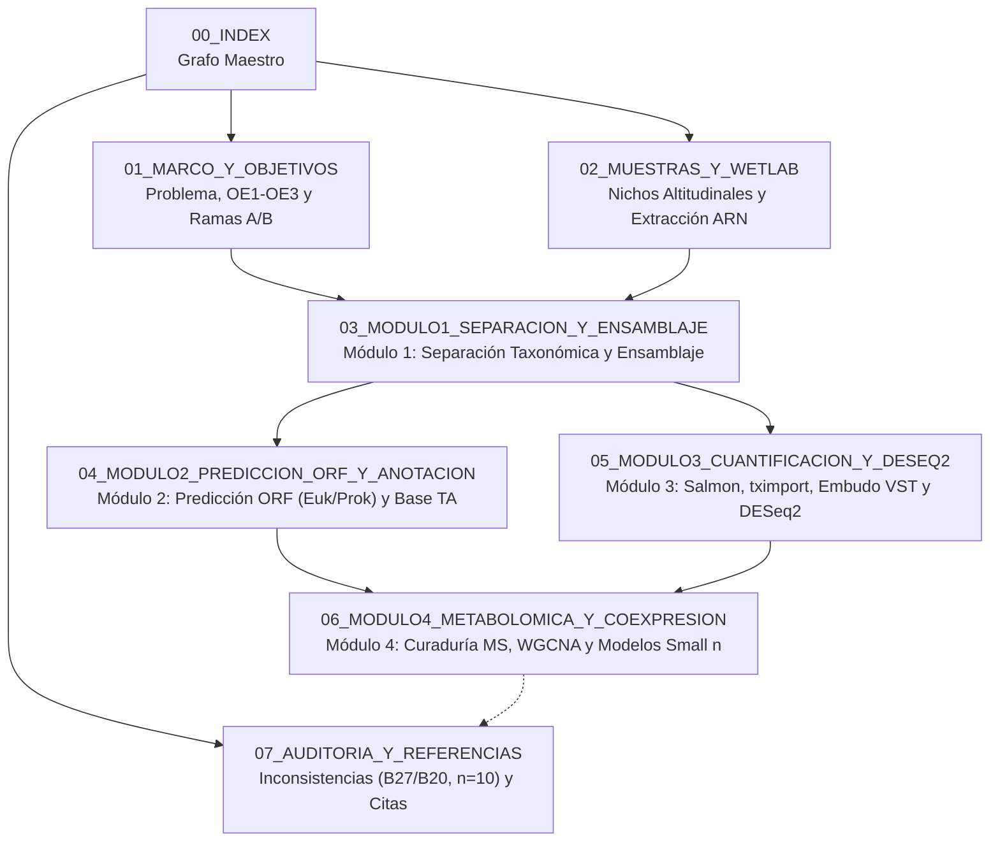

# `00_INDEX` — Grafo Maestro y Arquitectura de 4 Módulos

- **ID_Nodo**: `00_INDEX`
- **Título_Oficial**: *Desarrollo de un flujo computacional reproducible para caracterizar la expresión de genes precursores y biosintéticos de la ruta de alcaloides tropánicos en plantas y sus microorganismos asociados en el clado Datura.*
- **Enfoque_Metodológico**: Cuantitativo *in silico* de hologenómica (Dual RNA-seq) que integra metatranscriptómica foliar y perfiles metabolómicos en especies del clado *Datura*.

---

## 1. Arquitectura Operativa de 4 Módulos

La arquitectura **LLMWiki** se estructura en **8 nodos modulares** que articulan los **4 módulos operativos** del flujo bioinformático junto con **3 nodos transversales** de contexto biológico, inventario experimental y auditoría metodológica:

### Desglose de Módulos Operativos

1. **Módulo 1 (Separación Taxonómica)**: Generación de matrices de lecturas y co-ensamblajes independientes para planta hospedera y microorganismos asociados ([[03_MODULO1_SEPARACION_Y_ENSAMBLAJE]]).
2. **Módulo 2 (Construcción Funcional)**: Predicción de marcos de lectura abiertos ($\text{Transcrito} \rightarrow \text{Proteína}$) diferenciada por reino y anotación de enzimas de la ruta ([[04_MODULO2_PREDICCION_ORF_Y_ANOTACION]]).
3. **Módulo 3 (Caracterización de la Ruta)**: Cuantificación de abundancia, corrección por longitud efectiva, estabilización de varianza (VST) y expresión diferencial entre nichos altitudinales ([[05_MODULO3_CUANTIFICACION_Y_DESEQ2]]).
4. **Módulo 4 (Integración Expresión y Metabolómica)**: Curaduría de alcaloides, redes de co-expresión (WGCNA), correlación cruzada de *Eigengenes* planta-endófito y métodos multivariados para tamaño muestral reducido ([[06_MODULO4_METABOLOMICA_Y_COEXPRESION]]).

---

## 2. Nodos Transversales

- **[[01_MARCO_Y_OBJETIVOS]]**: Planteamiento del problema, pregunta, objetivos y bifurcación metodológica (Rama A dirigida por lecturas vs. Rama B *de novo* por contigs).
- **[[02_MUESTRAS_Y_WETLAB]]**: Inventario biológico, clasificación ecológica (alta montaña vs. tierras bajas), genomas de referencia para descontaminación y protocolo húmedo.
- **[[07_AUDITORIA_Y_REFERENCIAS]]**: Registro de errores críticos en matrices experimentales (`B27` vs. `B20`, columnas con ceros, $n=10$), incongruencias del borrador (`NewMethods.docx`) y bibliografía.

---

## 3. Mapa de Navegación Rápida del Repositorio

| Nodo | Archivo | Enfoque Técnico Principal |
| :--- | :--- | :--- |
| `00_INDEX` | `00_INDEX.md` | Grafo maestro y arquitectura de 4 módulos |
| `01_MARCO_Y_OBJETIVOS` | `01_MARCO_Y_OBJETIVOS.md` | Problema, objetivos, ramas analíticas y subclados |
| `02_MUESTRAS_Y_WETLAB` | `02_MUESTRAS_Y_WETLAB.md` | Muestras, nichos altitudinales, genomas y ARN |
| `03_MODULO1_SEPARACION_Y_ENSAMBLAJE` | `03_MODULO1_SEPARACION_Y_ENSAMBLAJE.md` | FastqPuri, rnaSPAdes y validación estructural |
| `04_MODULO2_PREDICCION_ORF_Y_ANOTACION` | `04_MODULO2_PREDICCION_ORF_Y_ANOTACION.md` | TransDecoder vs Prodigal, base TA y DIAMOND |
| `05_MODULO3_CUANTIFICACION_Y_DESEQ2` | `05_MODULO3_CUANTIFICACION_Y_DESEQ2.md` | Salmon, tximport, embudo VST ($36.647$ / $54.363$ transcritos) y expresión diferencial |
| `06_MODULO4_METABOLOMICA_Y_COEXPRESION` | `06_MODULO4_METABOLOMICA_Y_COEXPRESION.md` | Curaduría MS ($79$ picos: $76\text{ TA} + 3\text{ P}$), WGCNA ($22$ módulos sin `B19`, `grey=8,10%`), Fase 2 ($101$ asociaciones) y sPLS/MOFA+ |
| `07_AUDITORIA_Y_REFERENCIAS` | `07_AUDITORIA_Y_REFERENCIAS.md` | Auditoría forense (`B27`/`B20`, $n=8/9$, corrupción decimal CSV vs. Excel en $61/79$ columnas) y citas |

---

## 4. Inventario de Matrices y Scripts Validados en el Repositorio

| Archivo | Dimensiones / Contenido | Propósito en el Flujo |
| :--- | :--- | :--- |
| `matriz_vst_filtrada_para_WGCNA.csv` | $10\text{ muestras} \times 36.647\text{ transcritos}$ | Matriz de expresión VST filtrada por MAD (`B9, B10, B11, B12, B14, B15, B17, B19, B21, B27`). |
| `Metaboloma_WGNA_TESIS.xlsx` | $10\text{ muestras} \times 79\text{ compuestos}$ | Matriz metabolómica fuente ($76$ alcaloides `6T..81T` + $3$ precursores `82P..84P`; muestras `B21, B9, B12, B14, B10, B11, B15, B19, B17, B20`). |
| `fenotipos_TA_corregidos_para_WGCNA.csv` | $10\text{ muestras} \times 79\text{ compuestos}$ | Matriz metabolómica con los $339$ puntos decimales `.X`/`.XX` recuperados desde el XML de `Metaboloma_WGNA_TESIS.xlsx` (corrige la distorsión de `fenotipos_TA_limpios_para_WGCNA.csv`). |
| `fenotipos_TA_homologados_n8_SinOutgroups.csv` | $8\text{ muestras} \times 79\text{ compuestos}$ | Matriz metabolómica corregida y ordenada exactamente igual que la expresión sin *outgroups* (`B9, B10, B11, B12, B14, B15, B17, B21`). |
| `WGCNA1_Data.R` / `WGCNA1_Sin_B19_Comparativa.py` | Scripts Fase 1 (R / Python) | Construcción de los $22$ módulos de co-expresión (`power = 12`, `signed`, sin `B19`, etapa PAM, `grey = 8.10%`). |
| `WGCNA2_Correlacion_Metaboloma.R` / `.py` | Scripts Fase 2 (R / Python) | Cruce de los $22$ *Module Eigengenes* contra los $79$ compuestos ($101$ asociaciones significativas con $\|r\| \ge 0.70, p \le 0.05$). |
| `Resultados_por_Objetivos/` | Organización por Objetivos (OE1, OE2, OE3) | Clasificación completa de scripts, tablas CSV, figuras (`Fig01`–`Fig10`) y guías didácticas (`INDICE_REPOSITORIO_POR_OBJETIVOS.md` y `GUIA_FACIL_RESULTADOS_OBJETIVO_3.md`). |
